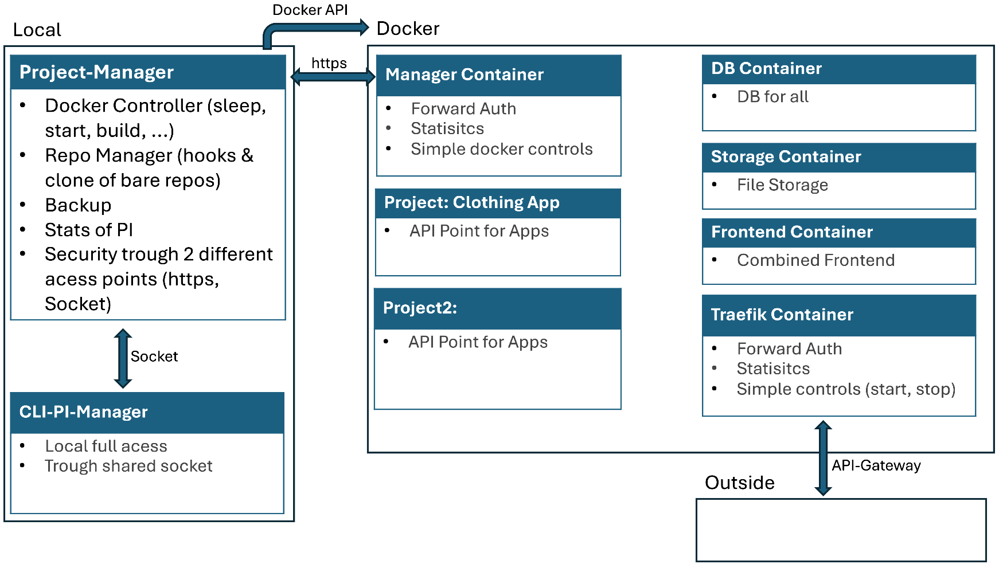

# zero-to-scale-PI-Manager

### ⚠️ **Context & Status**
A lightweight, self-hosted automation server and orchestration manager built specifically for isolated Raspberry Pi environments. The system acts as a central control plane for local bare Git repositories, automated backups, and dynamic, dependency-aware Docker container scaling (including on-demand container sleep and wake cycles).

---

### 🛠️ TechStack

### Current Implementation
* **Core Language:** Python 3
* **API Framework:** FastAPI, Uvicorn
* **Inter-Process Communication:** Unix Domain Sockets
* **Version Control Ingress:** Local Bare Git Repositories & Custom Git Hooks

### Planned Architecture
* **Frontend Operations:** React (Administrative Dashboard)
* **Ingress Edge:** Traefik (Reverse Proxy & Forward Auth)
* **Telemetry & Resilience:** Custom Pi-Watcher (Hardware watchdog daemon) & Dedicated Automated Backup Solutions

---

## Quick Start & Development Setup

### 0. Dynamic Structural Dependency Resolution
For synchronization across decoupled interfaces, content inside the `shared/` folder must be copied into both the `manager/` and `commandline/` directories. 

In production, this is orchestrated natively on the Pi via a customized deployment hook. This hook also acts as an architectural gatekeeper, preventing the active manager instance from pulling unstable, conflicting structural variations from development clones.

### 1. Installation & Environment Setup
Clone the repository and prepare the isolated virtual environment:
```bash
# Initialize and activate the virtual environment
python3 -m venv .venv
source .venv/bin/activate

# Install all project dependencies
pip install -r requirements.txt
```

### 2. Running the Infrastructure
*Ensure your virtual environment is active (`source .venv/bin/activate`) before running these components.*

#### Launch the Core Management Daemon (Server):
Run the FastAPI application from the repository root:
```bash
uvicorn manager.main:app --reload
```

#### Interact via the Administrative CLI (Client):
Open a separate terminal shell and execute the helper utility:
```bash
python client.py -help
```

---

## Project Roadmap & Changelog
### Architecture & System Design
The system is cleanly split into a low-level local manager, a secure CLI, a https Interface to the manager (less rights), a traefik container (forward auth, currently planed for zero-to-scale), a manager container (layer between local Hardware and Container aswell as API routes) and a sandboxed Docker infrastructure. More details can be found in the below file:


For this to work I also setup a bare-repo creater on my PI, that setups a service.yml aswell as some other strucutres, which is used to determine the action the manager needs to take, like how to run and build it aswell as the dependencies. This will later be included in the Manager or the CLI.

### Accomplished (Production Ready)
* **Secure CLI Utilities:** Low-overhead command-line interactions established.
* **Native Socket Server:** Fully functional asynchronous IPC communication within the host Manager.
* **Structural Refactoring:** Architectural isolation of application layers into strict interface boundaries.

### Current Sprint (In Progress)
* **Service Mocking:** Designing mock service layers, test frameworks, and the central command registry pattern.

### Planned (Backlog)
1. **Advanced Project Portals:** High-level lists and deep-dive detail view interfaces for repository telemetry.
2. **Docker Orchestration Layer:** Direct service-to-engine binding using a dedicated `DockerHandler`.
3. **Active Workspace Clones:** Automated staging environment creation from local bare repositories combined with commit hook loops.
4. **Declarative Manifests:** Complete schema parsing integration for incoming `service.yml` specifications.
5. **Asynchronous Task Queue:** Worker pool with priority sorting to handle long-running Docker image builds.
6. **Hardened API Gateway:** Implementation of containerized management routing, token-forwarding auth, and resource-saving container sleep triggers.
7. **Queue Optimization & Collision Merging:** Smart task merging logic to intercept, combine, or cancel redundant pending build jobs when multiple rapid pushes occur sequentially in the queue.
